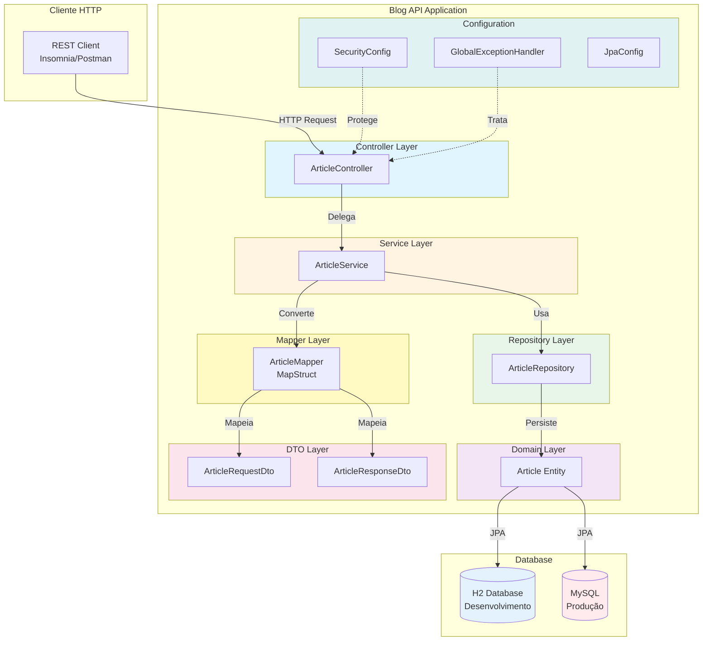
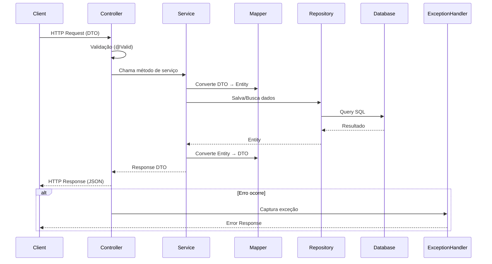

# Blog API

> **API REST** - Sistema completo de gerenciamento de artigos de blog desenvolvido com Spring Boot, demonstrando arquitetura em camadas e boas práticas de desenvolvimento.

[](https://www.oracle.com/java/)
[](https://spring.io/projects/spring-boot)
[](https://maven.apache.org/)
[](LICENSE)

## Sobre o Projeto

O **Blog API** é uma API REST completa para gerenciamento de artigos de blog, desenvolvida em Java utilizando Spring Boot Framework. O projeto demonstra arquitetura em camadas bem definidas, separação de responsabilidades e implementação de boas práticas de desenvolvimento, incluindo segurança, validação, tratamento de exceções e monitoramento.

### Objetivos

- Demonstrar arquitetura em camadas (Controller → Service → Repository)
- Implementar API REST completa com CRUD de artigos
- Aplicar boas práticas (DTOs, validação, tratamento de exceções, segurança)
- Suportar múltiplos ambientes (desenvolvimento com H2, produção com MySQL)
- Servir como **portfólio técnico** demonstrando competências em Spring Boot

## Arquitetura

### Conceito: Arquitetura em Camadas

O projeto segue o padrão de **arquitetura em camadas**, onde:

- **Controller**: Recebe requisições HTTP e delega para a camada de serviço
- **Service**: Contém a lógica de negócio e orquestra as operações
- **Repository**: Gerencia acesso aos dados através do Spring Data JPA
- **DTO**: Objetos de transferência de dados para isolamento da camada de domínio
- **Mapper**: Conversão automática entre DTOs e entidades usando MapStruct
- **Exception Handler**: Tratamento global de exceções

### Diagrama de Arquitetura em Camadas



### Fluxo de Requisição



## Stack Tecnológica

### Core
- **Java 21** - Linguagem de programação
- **Spring Boot 3.2.0** - Framework principal
- **Spring Security** - Autenticação e autorização
- **Spring Data JPA** - Persistência de dados
- **Bean Validation** - Validação de dados
- **Spring Actuator** - Monitoramento e métricas

### Banco de Dados
- **H2 Database** - Banco em memória para desenvolvimento/testes
- **MySQL 8.0+** - Banco de dados para produção

### Ferramentas
- **Maven** - Gerenciamento de dependências e build
- **Lombok** - Redução de código boilerplate
- **MapStruct** - Mapeamento automático DTO ↔ Entity
- **JUnit 5** - Framework de testes
- **Mockito** - Framework de mocking para testes

### Modos de Execução

O projeto foi projetado para rodar **sem necessidade de infraestrutura complexa**, oferecendo dois modos de execução:

- **Desenvolvimento**: H2 em memória para rodar rapidamente sem configuração
- **Produção**: MySQL para ambiente de produção com configuração via variáveis de ambiente

Esta abordagem demonstra flexibilidade para diferentes cenários sem complexidade desnecessária.

## Estrutura do Projeto

```
blog-api/
├── src/
│   ├── main/
│   │   ├── java/com/aronalvarenga/blog/
│   │   │   ├── config/                 # Configurações da aplicação
│   │   │   │   ├── JpaConfig.java
│   │   │   │   ├── SecurityConfig.java
│   │   │   │   └── GlobalExceptionHandler.java
│   │   │   ├── controller/             # Controladores REST
│   │   │   │   └── ArticleController.java
│   │   │   ├── dto/                    # Data Transfer Objects
│   │   │   │   ├── ArticleRequestDto.java
│   │   │   │   └── ArticleResponseDto.java
│   │   │   ├── exception/              # Exceções personalizadas
│   │   │   │   └── ResourceNotFoundException.java
│   │   │   ├── mapper/                 # Mapeadores MapStruct
│   │   │   │   └── ArticleMapper.java
│   │   │   ├── model/                  # Entidades JPA
│   │   │   │   └── Article.java
│   │   │   ├── repository/             # Repositórios JPA
│   │   │   │   └── ArticleRepository.java
│   │   │   ├── service/                # Lógica de negócio
│   │   │   │   └── ArticleService.java
│   │   │   └── BlogApiApplication.java # Classe principal
│   │   └── resources/
│   │       ├── application.yml         # Configuração base
│   │       ├── application-dev.yml    # Configuração desenvolvimento
│   │       └── application-prod.yml   # Configuração produção
│   └── test/
│       └── java/com/aronalvarenga/blog/
├── pom.xml
└── README.md
```

## Como Executar

### Pré-requisitos

- **Java 21+**
- **Maven 3.6+**
- **MySQL 8.0+** (apenas para produção - opcional)

### ⚠️ IMPORTANTE: Desenvolvimento com H2

**No modo desenvolvimento, a aplicação usa H2 em memória automaticamente.** Você **NÃO precisa** configurar variáveis de ambiente para desenvolvimento. O H2 é configurado automaticamente no arquivo `application-dev.yml`.

**Console H2 disponível em:** `http://localhost:8080/h2-console`
- **JDBC URL:** `jdbc:h2:mem:blogdb`
- **Username:** `sa`
- **Password:** (deixe em branco)

### Executando Localmente

1. **Clone o repositório**
   ```bash
   git clone https://github.com/aron-alvarenga/blog-api.git
   cd blog-api
   ```

2. **Execute a aplicação em modo desenvolvimento** (usa H2 em memória automaticamente)

   **Windows (PowerShell):**
   ```powershell
   # Opção 1: Com aspas (RECOMENDADO)
   mvn spring-boot:run "-Dspring-boot.run.profiles=dev"
   
   # Opção 2: Usando variável de ambiente
   $env:SPRING_PROFILES_ACTIVE="dev"
   mvn spring-boot:run
   
   # Opção 3: Sem especificar profile (usa 'dev' por padrão)
   mvn spring-boot:run
   ```

   **Windows (CMD):**
   ```cmd
   mvn spring-boot:run -Dspring-boot.run.profiles=dev
   ```

   **Linux/macOS:**
   ```bash
   mvn spring-boot:run -Dspring-boot.run.profiles=dev
   ```

   **Nota:** No modo desenvolvimento, a aplicação usa H2 em memória automaticamente. Não é necessário configurar MySQL ou variáveis de ambiente.

3. **Acesse a aplicação**
   - API: `http://localhost:8080`
   - Actuator Health: `http://localhost:8080/actuator/health`
   - H2 Console: `http://localhost:8080/h2-console` (apenas em desenvolvimento)

### Executando em Produção (com MySQL)

#### Configuração de Variáveis de Ambiente

Para produção, você precisa configurar as seguintes variáveis de ambiente:

**Windows (PowerShell):**
```powershell
# Database Configuration
$env:DATABASE_URL="jdbc:mysql://localhost:3306/blog_db?useTimezone=true&serverTimezone=UTC&createDatabaseIfNotExist=true"
$env:DATABASE_USERNAME="root"
$env:DATABASE_PASSWORD="sua_senha_aqui"

# Server Configuration
$env:SERVER_PORT="8080"

# Execute a aplicação
mvn spring-boot:run "-Dspring-boot.run.profiles=prod"
```

**Nota:** No PowerShell, essas variáveis são válidas apenas para a sessão atual. Para torná-las permanentes:

```powershell
[System.Environment]::SetEnvironmentVariable("DATABASE_URL", "jdbc:mysql://localhost:3306/blog_db?useTimezone=true&serverTimezone=UTC", "User")
[System.Environment]::SetEnvironmentVariable("DATABASE_USERNAME", "root", "User")
[System.Environment]::SetEnvironmentVariable("DATABASE_PASSWORD", "sua_senha_aqui", "User")
```

**Windows (CMD):**
```cmd
set DATABASE_URL=jdbc:mysql://localhost:3306/blog_db?useTimezone=true&serverTimezone=UTC&createDatabaseIfNotExist=true
set DATABASE_USERNAME=root
set DATABASE_PASSWORD=sua_senha_aqui
set SERVER_PORT=8080
mvn spring-boot:run -Dspring-boot.run.profiles=prod
```

**Linux/macOS:**
```bash
export DATABASE_URL="jdbc:mysql://localhost:3306/blog_db?useTimezone=true&serverTimezone=UTC&createDatabaseIfNotExist=true"
export DATABASE_USERNAME="root"
export DATABASE_PASSWORD="sua_senha_aqui"
export SERVER_PORT="8080"
mvn spring-boot:run -Dspring-boot.run.profiles=prod
```

**Para tornar permanentes no Linux/macOS**, adicione ao arquivo `~/.bashrc` ou `~/.zshrc`:

```bash
echo 'export DATABASE_URL="jdbc:mysql://localhost:3306/blog_db?useTimezone=true&serverTimezone=UTC"' >> ~/.bashrc
echo 'export DATABASE_USERNAME="root"' >> ~/.bashrc
echo 'export DATABASE_PASSWORD="sua_senha_aqui"' >> ~/.bashrc
echo 'export SERVER_PORT="8080"' >> ~/.bashrc
source ~/.bashrc
```

#### Configuração do MySQL

1. **Instale o MySQL 8.0+**
   - Windows: [MySQL Installer](https://dev.mysql.com/downloads/installer/)
   - Linux: `sudo apt-get install mysql-server` (Ubuntu/Debian)
   - macOS: `brew install mysql`

2. **Crie o banco de dados**
   ```sql
   CREATE DATABASE blog_db CHARACTER SET utf8mb4 COLLATE utf8mb4_unicode_ci;
   ```

3. **Crie um usuário (opcional)**
   ```sql
   CREATE USER 'blog_user'@'localhost' IDENTIFIED BY 'senha_segura';
   GRANT ALL PRIVILEGES ON blog_db.* TO 'blog_user'@'localhost';
   FLUSH PRIVILEGES;
   ```

4. **Verifique a conexão**
   ```bash
   mysql -u root -p -e "SHOW DATABASES;"
   ```

### Troubleshooting

#### Problema: Aplicação não inicia em modo produção

**Solução:**
1. Verifique se as variáveis de ambiente estão configuradas corretamente
2. Verifique se o MySQL está rodando: `mysql -u root -p`
3. Verifique se o banco de dados existe: `SHOW DATABASES;`
4. Verifique as credenciais no arquivo `application-prod.yml`

#### Problema: Erro de conexão com MySQL

**Solução:**
1. Verifique se o MySQL está rodando
2. Verifique se a porta 3306 está acessível
3. Verifique se o usuário tem permissões no banco de dados
4. Verifique se o timezone está configurado corretamente na URL de conexão

#### Problema: H2 Console não aparece

**Solução:**
1. Certifique-se de que está usando o profile `dev`
2. Verifique se `spring.h2.console.enabled=true` no `application-dev.yml`
3. Acesse `http://localhost:8080/h2-console`

## Endpoints da API

### Endpoints Públicos

| Método | Endpoint | Descrição |
|--------|----------|-----------|
| `GET` | `/api/v1/articles/published` | Lista todos os artigos publicados |
| `GET` | `/api/v1/articles/published/paginated` | Lista artigos publicados com paginação |
| `GET` | `/api/v1/articles/published/search?title=termo` | Busca artigos publicados por título |
| `GET` | `/api/v1/articles/{id}` | Busca artigo por ID (se publicado) |
| `GET` | `/actuator/health` | Health check da aplicação |
| `GET` | `/h2-console` | Console H2 (apenas em desenvolvimento) |

### Endpoints Protegidos

| Método | Endpoint | Descrição |
|--------|----------|-----------|
| `GET` | `/api/v1/articles` | Lista todos os artigos |
| `GET` | `/api/v1/articles/paginated` | Lista artigos com paginação |
| `GET` | `/api/v1/articles/search?title=termo` | Busca artigos por título |
| `GET` | `/api/v1/articles/author/{author}` | Busca artigos por autor |
| `POST` | `/api/v1/articles` | Cria novo artigo |
| `PUT` | `/api/v1/articles/{id}` | Atualiza artigo existente |
| `DELETE` | `/api/v1/articles/{id}` | Exclui artigo |
| `PATCH` | `/api/v1/articles/{id}/publish` | Publica artigo |
| `PATCH` | `/api/v1/articles/{id}/unpublish` | Despublica artigo |

## Testes

### Executando Testes

```bash
# Executar todos os testes
mvn test

# Executar testes com cobertura (quando configurado)
mvn test jacoco:report
```

### Estratégia de Testes

- **Testes Unitários**: Lógica de negócio e validações
- **Testes de Integração**: Endpoints e persistência
- **Testes de Segurança**: Endpoints protegidos

## Segurança

A aplicação implementa segurança básica com Spring Security:

- Endpoints públicos para leitura de artigos publicados
- Endpoints protegidos para operações de escrita
- Configuração preparada para implementação futura de JWT
- Tratamento global de exceções
- Validação de dados com Bean Validation

### Boas Práticas de Segurança

- **NUNCA** commite arquivos `.env` ou com credenciais
- Use variáveis de ambiente para dados sensíveis
- Em produção, configure um gerenciador de segredos (AWS Secrets Manager, Azure Key Vault, HashiCorp Vault, etc.)
- Mantenha as senhas de banco de dados seguras e complexas
- Use diferentes credenciais para desenvolvimento e produção

### Arquivos Sensíveis

Certifique-se de que os seguintes arquivos estão no `.gitignore`:

```
.env
*.env
application-local.yml
application-secrets.yml
```

## Monitoramento

A aplicação inclui Spring Actuator para monitoramento:

- **Health checks**: `/actuator/health`
- **Métricas**: `/actuator/metrics`
- **Informações**: `/actuator/info`

## Melhorias Implementadas

### Arquitetura
- Separação clara de responsabilidades (Controller, Service, Repository)
- Uso de DTOs para transferência de dados
- Mapeamento automático com MapStruct
- Tratamento global de exceções
- Validação de dados com Bean Validation

### Segurança
- Configuração de segurança básica
- Endpoints públicos e protegidos
- Variáveis de ambiente para dados sensíveis
- .gitignore atualizado para arquivos sensíveis

### Qualidade de Código
- Uso correto do Lombok
- Logging estruturado
- Testes unitários
- Documentação de código
- Configuração de profiles (dev/prod)

### Configuração
- Migração para YAML
- Profiles de desenvolvimento e produção
- Configuração de banco de dados otimizada
- Configuração de logging por ambiente


## Contribuindo

Este é um projeto de portfólio pessoal. Contribuições são bem-vindas! Sinta-se à vontade para abrir issues e pull requests.

## Licença

Este projeto está sob a licença MIT. Veja o arquivo [LICENSE](LICENSE) para mais detalhes.

## Autor

**Aron Alvarenga**

- GitHub: [@aron-alvarenga](https://github.com/aron-alvarenga)
- LinkedIn: [Aron Alvarenga](https://www.linkedin.com/in/aron-alvarenga)

## Agradecimentos

- Spring Framework e comunidade Spring
- Todos os mantenedores das bibliotecas open-source utilizadas

---

**Nota**: Este projeto demonstra boas práticas de desenvolvimento com Spring Boot, mantendo simplicidade e foco na qualidade do código.
